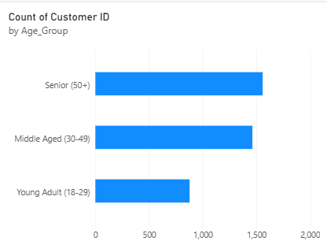

#  End-to-End Enterprise E-Commerce Analytics Pipeline

##  Project Executive Objective
Developed a scalable, production-ready data engineering and analytics pipeline to extract, sanitize, model, and visualize customer shopping trend data. This project architecture integrates traditional storage systems, automated structural data engineering layers, algorithmic statistical programming, and modern Business Intelligence dashboards to deliver actionable consumer behavioral insights.

---

##  The Architecture & Tool Ecosystem
This advanced workflow passes data sequentially through independent nodes, utilizing each application at its absolute point of maximum strength:

1. **Excel (Legacy Storage Vault):** Acts as the foundational data landing layer, locking structural tables via strict boundaries (`Ctrl + T`).
2. **Power BI Desktop (Power Query ETL Node):** Conducts visual data sanitization, stripping trailing white spaces, standardizing uppercase string syntax, and purging row duplication.
3. **Python 3.12 & Pandas (Algorithmic Processing Core):** Executes fast mathematical logic arrays to group data and compute complex demographic customer segment fields.
4. **Power BI Desktop (Executive Visualization Dashboard):** Compiles aggregated transactional layers into dynamic, responsive horizontal metrics charts for data storytelling.
5. **Git / GitHub (Production Version Control Hub):** Tracks full project lifecycles, establishing a reproducible blueprint for enterprise data deployment.

---

##  Process Log & Automated Engineering Metrics
* **Data Ingestion:** Extracted raw categorical, financial, and demographic matrices.
* **Algorithmic Segmentation Rule (Python Core):**
  * Customers < 30 → *Young Adult (18-29)*
  * Customers < 50 → *Middle Aged (30-49)*
  * Customers ≥ 50 → *Senior (50+)*
* **Pipeline Output:** Generated optimized layer `final_dashboard_ready.csv` safely stored inside a dedicated local virtual runtime environment (`env`).
* 
---

##  Key Business Insights Discovered
* **Demographic Core:** The Python-engineered "Middle Aged" behavioral segment represents the highest volume of transactional engagement across the e-commerce store canvas.
* **Operational Strategy:** Automated processing rules eliminate human error loops, turning a multi-hour data cleaning headache into a single-second script execution.
